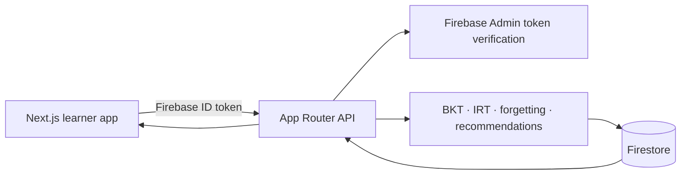

# CareerTwin-AI

CareerTwin-AI is a career learning platform that turns quiz evidence into an adaptive practice plan. It tracks learned mastery separately from estimated recall, uses the learner’s target role to identify skill relevance, and keeps sensitive learning updates on the server.

## Architecture



The Firebase browser SDK is used for email/password Authentication only. Route handlers validate bearer tokens with Firebase Admin, validate payloads with Zod, and access Firestore with the Admin SDK. All user paths are scoped to the verified UID. Firestore client rules deny direct access to private state, so clients cannot forge events, mastery, or quiz correctness.

## Features

- Email/password signup and login with Firebase Authentication.
- Career Twin profile, skill and concept mastery, retention estimates, learning history, revision queue, and target-role-aware recommendations.
- Adaptive quizzes selected by 2PL IRT information and weak-concept relevance. The server omits answer keys until an answer is submitted.
- BKT updates concept mastery only from validated answers; elapsed time affects retention, never learned mastery.
- Small shared catalog of skills, concepts, questions, and role requirements, safe to seed repeatedly.
- Responsive dashboard and learner views with loading, error, empty, and not-configured states.

## Learning engines

### BKT

`lib/learning/bkt.ts` implements posterior mastery for correct and incorrect evidence using configurable `pL0`, `pT`, `pS`, and `pG` values from `lib/learning/config.ts`. It applies the learning transition after the observation and clamps mastery to [0, 1].

### IRT

`lib/learning/irt.ts` uses the 2PL logistic curve `P = 1 / (1 + exp(-a(theta-b)))`, item information `a²P(1-P)`, and an iterative MAP-style ability estimate. Selection filters attempted questions, then scores item information with a weak-concept boost and deterministic tie-breaking.

### Forgetting and spaced repetition

Retention is `mastery * exp(-lambda * elapsedDays)`. It is calculated at read/recommendation time from the last practice timestamp; before the first practice it equals the mastery baseline. It does not write back a lower mastery. Previously practiced concepts below the configured review threshold enter the revision queue, ordered by retention, mastery, importance, and elapsed time. New concepts are practice candidates, not overdue revisions.

### Next Best Action

The contextual UCB-inspired score combines weakness, current retention, target-role relevance, concept importance, available time, and an uncertainty term derived from the number of observed answers. No random exploration is used, so identical state yields a repeatable recommendation. It is an MVP contextual bandit policy: observed answer counts represent uncertainty, while long-term reward attribution and action history are not yet persisted.

### Knowledge graph

Nodes represent jobs, skills, and concepts; edges represent required skills, contained concepts, and concept prerequisites. Graph utilities support deterministic traversal. Courses are not yet included in the seeded catalog.

## Firestore model

Shared seed data:

- `skills/{skillId}` and `skills/{skillId}/concepts/{conceptId}`
- `questions/{questionId}` (answer keys are accessible only to trusted server code)
- `jobs/{jobId}`
- `knowledgeGraph/nodes/{nodeId}` and `knowledgeGraph/edges/{edgeId}`

Per-user documents, scoped under the verified auth UID:

- `users/{uid}/digitalTwin/profile`
- `users/{uid}/skills/{skillId}` and `users/{uid}/concepts/{conceptId}`
- `users/{uid}/learningEvents/{eventId}`
- `users/{uid}/quizAttempts/{quizId}`

Learning events include event type, skill/concept/question, server-computed correctness, difficulty, response time, and server timestamp in milliseconds. Quiz answers, events, concept state, skill state, and the Career Twin update together in a Firestore transaction. Re-submitting the same current question returns a conflict.

## API

All learning endpoints require `Authorization: Bearer <Firebase ID token>`.

| Method | Endpoint | Purpose |
|---|---|---|
| GET, PATCH | `/api/learning/digital-twin` | Read or update career goal, role, and available time |
| GET | `/api/learning/skills` | Skills and concept progress |
| GET | `/api/learning/skills/:skillId` | One skill detail |
| GET | `/api/learning/mastery` | Skill and concept state |
| GET | `/api/learning/recommendation` | Current contextual action |
| GET | `/api/learning/revision` | Revision queue |
| GET | `/api/learning/history` | Recent learning events |
| POST | `/api/learning/quiz/start` | Start a quiz for a skill |
| POST | `/api/learning/quiz/next` | Get the current server-selected question |
| POST | `/api/learning/answer` | Validate answer, update learning state, return next question |
| GET | `/api/jobs` | Available career roles |
| GET | `/api/knowledge-graph` | Nodes and edges |

## Local setup

Requirements: Node.js 20+ and a Firebase project.

1. Install packages: `npm install`.
2. Copy `.env.example` to `.env.local` and fill the Firebase web configuration plus server Admin configuration. Locally, Firebase Admin can also use Application Default Credentials after `gcloud auth application-default login` and setting `FIREBASE_PROJECT_ID`.
3. In Firebase Console, enable Email/Password sign-in and create a Firestore database.
4. Deploy `firestore.rules` to the project: `firebase deploy --only firestore:rules` (Firebase CLI must be installed and logged in).
5. Load the shared catalog: `npm run seed`.
6. Start the app: `npm run dev`, then visit `http://localhost:3000`.

Never put a service account JSON file in the repository. `FIREBASE_PRIVATE_KEY` should be stored only in a local ignored environment file or deployment secret manager. The app displays setup guidance when the public Firebase web config is absent; protected server APIs return 503 when Admin credentials are absent.

## Environment variables

See `.env.example`: four `NEXT_PUBLIC_FIREBASE_*` values configure the browser Auth SDK. `FIREBASE_PROJECT_ID`, `FIREBASE_CLIENT_EMAIL`, and `FIREBASE_PRIVATE_KEY` configure Admin; alternatively use Application Default Credentials. `FIREBASE_AUTH_EMULATOR_HOST` is optional for local Auth emulator development.

## Seed data

`npm run seed` merge-writes 14 skills across JavaScript, TypeScript, React, SQL, DSA, Next.js, Node.js, Express, MongoDB, Docker, Git, AWS, Python, and Linux; 20 concepts; meaningful quiz questions; seven career roles; and graph relationships. It is idempotent and does not touch user documents. Extend the catalog in `lib/learning/catalog.ts` before reseeding.

## Tests and build

```sh
npm run lint
npm run typecheck
npm test
npm run build
```

Algorithm tests cover BKT, IRT, forgetting, revision ordering, recommendations, and graph traversal. Live API and Firebase integration checks require configured Firebase credentials and are not simulated by the unit suite.

## Deployment

Deploy as a standard Next.js App Router application. Add the public Firebase config and server Admin credentials as protected deployment environment variables, deploy Firestore rules, run the seed script once, and configure the platform build command as `npm run build`. The revision logic is a pure reusable service and can be called from a future scheduled function; this MVP computes retention lazily when reading progress.

## Current MVP boundaries

The product catalog is seeded as a useful MVP, not a complete course library. Resume analysis, job-market ingestion, interview practice, lesson completion and reward attribution are not connected to external sources in this version. The recommendation policy is deterministic and bandit-inspired but does not yet persist action rewards. Configure a Firebase project to exercise authenticated end-to-end persistence.
